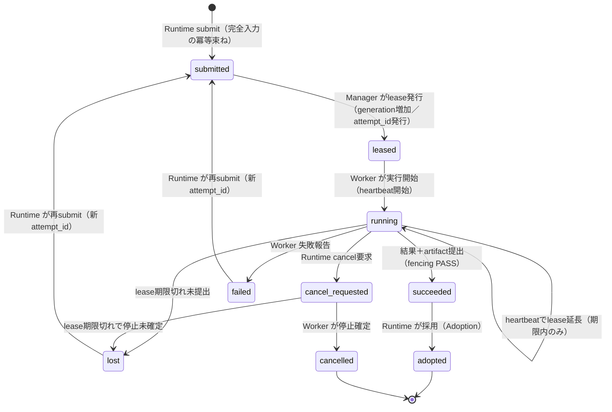

# T-098 ResearchJob v1 プロトコル設計案（Proposal）

**ステータス**：設計案のみ（未実装・未受入・未採用）．実行可能な contract／schema／endpoint／採用は存在しない．
**対象タスク**：T-098 ephy-worker protocol／job contract の設計．
**関連**：ADR-0003（既存 web.collect 0.4 との互換維持），T-122（共通 knowledge-lifecycle 契約＝kirimine170/ephy issue 5 の依存であり，Karte 連携仕様ではない）．

## 1. スコープと非目標

### スコープ
- `ResearchJob` v1 の JSON エンベロープ定義と submit〜audit のライフサイクル設計．
- 既存 `web.collect` 0.4 契約との明確な分離と，同一 Manager 上での共存可能性の提案．
- 古い lease generation／古い revision による実行を防ぐ fencing の定義．
- 結果採用（Adoption）権限を Runtime へ置き，Worker の Karte 書き込みを禁止する責任分界．

### 非目標
- 実装コード，schema 登録，endpoint 追加，リポジトリ変更，Runtime／Karte との統合．
- 既存 `web.collect` 0.4 の仕様変更または廃止．
- 認証・認可基盤の新設（既存の HTTP header credential 運用を前提とする）．
- 分散合意や投票による真実性の決定（Worker は独立した証拠収集のみ行う）．

## 2. 既存 web.collect 0.4 との共存（現状の実装済み契約）

以下は `src/ephy_worker/contracts.py` と `src/ephy_worker/manager.py` に実装済みの現状であり，ResearchJob v1 の保証ではない．

- `contract = "0.4"`，`kind = "web.collect"`，mode は `search`／`extract` の discriminated union．
- submit は `submit_key` と `input_hash`（canonical JSON の SHA-256）で一意，同一 `submit_key` への別入力は `submit_key_conflict`（409）．
- job state は queued／running／cancel_requested／completed／partial／failed／cancelled／lost，`TERMINAL_STATES` は後述の terminal 集合．
- `Attempt` は `lease_token`，`lease_expires_at`，`attempt_number` を持ち，renew／finalize／artifact 提出は lease token と期限で検査される．
- artifact は job と attempt に紐づけ，名前は安全文字列，media type は許可リスト（application/json，text/html，application/pdf，text/plain），SHA-256 と bytes を検証．
- retry は parent の残 budget と残時間から child budget を導出し，全量再付与しない．

ResearchJob v1 は上記の仕組みを再利用する別の `job_type` として設計し，0.4 の field 意味を上書きしない．

## 3. 依存関係と未解決事項

- **T-033**：Runtime 側の Job ポリシー定義と結果採用ロジックの確定（未確認）．
- **T-122**：共通 knowledge-lifecycle 契約（kirimine170/ephy issue 5）との整合確認（未確認）．Karte との書き込み権限分離そのものは扱わない．
- **T-084**：main への統合確認と既存 ADR との整合性検証（未確認）．

これらが未解決の間，本文書は提案であり，実装可能な契約として扱わない．

## 4. バージョン付き JSON エンベロープ（提案）

すべての通信は `protocol_version` を含む JSON で行う．`web.collect` 0.4 との混同を防ぐため `job_type` を明示する．識別子はすべて公開の合成例であり，実 Job，実スプレッドシート ID，実 URL，ローカルパス，資格情報は含まない．

```json
{
  "protocol_version": "1.0",
  "job_type": "research_job",
  "job_id": "rjob-synthetic-0001",
  "attempt_id": "att-synthetic-0001-1",
  "target_revision": "aaaaaaaaaaaaaaaaaaaaaaaaaaaaaaaaaaaaaaaa",
  "policy_revision": "bbbbbbbbbbbbbbbbbbbbbbbbbbbbbbbbbbbbbbbb",
  "lease_generation": 1,
  "created_at": "2026-10-15T01:00:00Z",
  "expires_at": "2026-10-15T01:30:00Z",
  "payload": {
    "query_scope": "public_web_only",
    "constraints": {
      "max_results": 10,
      "allowed_domains": ["example.com"]
    }
  }
}
```

`payload` 内には資格情報，プライベートなコンテキスト，ローカルパスを含めない．

## 5. ライフサイクル契約（提案）

- **Submit**：Runtime が Job を作成し Manager へ送信．`target_revision` と `policy_revision` を必須とする．
- **Lease**：Worker が Job を pull し lease を取得．`lease_generation` は Manager 側のみが増加させる整数で，古い generation の lease は無効．`attempt_id` は lease 取得ごとに Manager が発行する一意 ID．
- **Execute／Heartbeat**：Worker は `attempt_id` と `lease_generation` を添えて実行状態を送信．heartbeat は有効期限内の lease 延長のみを試み，期限切れ後の延長は不可（0.4 の `lease_expired`／`deadline_passed` 相当を拒否として定義）．
- **Artifact**：結果は一時アップロード後に Manager 側で SHA-256 と size を検証して受領．許可 media type のみ受け入れる．
- **Cancel**：Runtime が cancel を要求．Worker は `cancelled` 確定まで `cancel_requested` を維持し，取消確定後の遅延結果は拒否．
- **Retry**：自動再実行はしない．再試行と新 `attempt_id` の発行は信頼された Manager／Runtime のみが行い，Worker は自分へ retry や権限を付与できない．
- **Audit**：状態遷移，lease 発行，artifact 受領，拒否理由を監査ログへ記録．ログに資格情報を含めない．

## 6. Fencing と独立 revision 検証

- **独立検証**：`target_revision` は凍結済みの期待 `target_revision` と，`policy_revision` は凍結済みの期待 `policy_revision` と，それぞれ別々に照合する．2 種類の revision を互いに比較しない．いずれか不一致なら実行を拒否し `revision_mismatch` を返す．
- **Stale lease generation**：古い `lease_generation`，期限切れ lease，別 attempt の token を持つ提出は `stale_lease` として拒否し，ネットワーク遅延による旧 Worker の書き込みを防ぐ．
- **Terminal 状態の拒否**：`cancelled` または `lost` の Job には，旧 `attempt_id` や旧 `lease_generation` が一致しても遅延結果を受け付けない．terminal 拒否を attempt／lease fencing と同時に定義する．

## 7. 冪等 submit と再試行

- **冪等 submit**：submit キーは完全な非変更入力（`target_revision`，`policy_revision`，scope，budget，payload 込み）のハッシュへ束ねる．同一キー・同一入力は既存 Job を返す成功，同一キー・異入力は失敗（0.4 の `submit_key_conflict` 相当）．payload だけの一致では冪等とみなさない．
- **結果提出**：同一 `attempt_id` からの同一結果の再送は成功，異なる結果は拒否．
- **再試行**：失敗時は信頼された Manager／Runtime が新しい `attempt_id` を発行して再 submit する．Worker 側の自動リトライは禁止．

## 8. 責任分界とプライバシー

- **Runtime**：Job ポリシーの定義，再試行の決定，結果の採用（Adoption），Karte への書き込み．
- **Worker**：公開 Web からの独立した探索，反証収集，出所の記録．Karte へ直接書き込まない．投票数で真実性を判断しない．
- **セキュリティ**：資格情報は HTTP header でのみ伝達し，payload，artifact，ログへ含めない．公開クエリと許可 scope のみを受け付け，プライベートデータへのアクセスを遮断する．

## 9. 計画状態グラフ（提案）



## 10. 状態遷移表（提案）

| 遷移 | actor | precondition | 結果状態 | 不正／遅延遷移の扱い |
|---|---|---|---|---|
| submit | Runtime | 完全入力のハッシュが未登録，revision／policy 凍結値と整合 | submitted | 同一キー・異入力は `submit_key_conflict` で拒否（既存 Job は不変） |
| submit（重複） | Runtime | 同一キー・同一入力 | submitted（既存返却） | 新規作成しない．成功として既存 Job を返す |
| lease | Worker | Job が submitted，Worker 登録済み・capability 一致 | leased | 二重 lease は最新 generation のみ有効．旧 generation は `stale_lease` |
| heartbeat | Worker | leased／running，lease 期限内，generation 一致 | 変更なし（lease 延長） | 期限切れ後は延長不可 `lease_expired`，terminal 状態は 410 相当で拒否 |
| artifact 提出 | Worker | 現 generation の lease 有効，media type 許可，SHA-256 一致 | 変更なし（受領） | 旧 generation／別 attempt token／size・hash 不一致は拒否 |
| finalize 成功 | Worker | 現 attempt が有効，Job が running | succeeded | 旧 attempt_id や terminal 状態からの提出は `stale_lease`／`terminal_state` で拒否 |
| cancel | Runtime | Job が submitted／leased／running | cancel_requested（queued 相当は即 cancelled） | 取消確定後の遅延結果は ID が一致しても拒否 |
| cancel 確定 | Worker | cancel_requested，Worker が停止完了 | cancelled | 以後の heartbeat／提出はすべて拒否 |
| lease 喪失 | Manager | lease 期限経過かつ未提出 | lost | 失効 attempt の後出し提出は拒否（terminal 拒否） |
| retry | Manager／Runtime のみ | 残 budget・残時間から child を導出可能 | submitted（新 attempt_id） | Worker が自己付与した retry は拒否．全量再付与はしない |
| adoption | Runtime のみ | Job が succeeded，監査ログ完全 | adopted | Worker 側の採用宣言は無効．Karte 書き込みは Runtime のみ |

## 11. 計画している合成受入 case（公開 synthetic ID のみ）

**positive**
1. 同一 `job_id` と同一完全入力の重複 submit が既存 Job を返す（新規行を作らない）．
2. lease 取得 → 期限内 heartbeat 延長 → 現 generation での finalize → Runtime adoption が成功する．
3. 失敗 Job に対し Runtime が新 `attempt_id` で再 submit し，child budget が parent の残量以下になる．
4. cancel 要求 → Worker 停止確定 → `cancelled`，以後の提出は拒否されるが Job 状態は不変．

**negative**
1. 同一 submit キーで payload または budget を変えた再 submit が失敗する（完全入力の不一致）．
2. 古い `lease_generation`，期限切れ lease，別 attempt token による結果・artifact 提出が拒否される．
3. `target_revision` を凍結値と，`policy_revision` を凍結値とそれぞれ別々に照合し，いずれか不一致で実行拒否される（2 つを互いに比較しない）．
4. `cancelled` または `lost` の Job へ旧 `attempt_id`／旧 `lease_generation` が一致する遅延結果を送っても terminal 拒否される．
5. Worker が自分で新しい `attempt_id` を付けて再試行した提出が拒否される（retry 権限は Manager／Runtime のみ）．
6. `protocol_version` 不一致，`job_type` 欠落，資格情報の payload 含意在検出で拒否される．

## 12. 将来の実装作業（未実施）

- JSON schema の確定と機械検証（本 docs の受入条件としての checker 追加）．
- Manager／Worker 間の lease・fencing・terminal 拒否のスタブ実装と合成 case 実行．
- `web.collect` 0.4 と `research_job` の同一 Manager 混在時の競合検証．
- Runtime 側の採用ロジック実装と T-033／T-122／T-084 の依存確認．
- `policy_revision` のハッシュ生成方法，`lease_generation` の永続化と復旧時挙動，大規模 artifact のストリーミングアップロード可否の決定．

**注記**：本文書は T-098 の設計候補であり，schema 検証も endpoint 実行も実施していない．承認，実装完了，採用を示さない．
