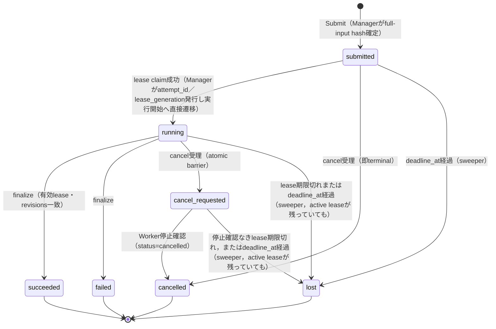

# T-098 ResearchJob v1 プロトコル設計案（Proposal）

**ステータス**：設計案（未実装・未受入・未採用）．本書はT-098のドキュメント設計提案のみであり，実行可能なcontract，schema，endpoint，checker，T-098完了，採用のいずれも主張しない．実行系とschema検証はすべてfuture workである．
**対象タスク**：T-098 ephy-worker protocol／job contractの設計．
**関連**：ADR-0003（既存 `web.collect` contract 0.4 との互換性維持）．

## 1. スコープと非目標

### スコープ
- `ResearchJob` v1 のJSONエンベロープ定義とライフサイクル（submit／lease／heartbeat／artifact／cancel／retry／audit）の設計．
- 既存の `web.collect` contract 0.4 との明確な分離と，同一Manager上での共存可能性の担保．
- 古いlease generation，古いrevision，取消済みJobによる書き込みを拒否するfencingの定義．
- 信頼済みManagerによるatomicな権限・状態検証と，Runtime側 Adoption の責任分界の定義．

### 非目標
- 実装コード，schema定義ファイル，endpointの作成，リポジトリへの実装変更，Runtime／Karteとの実統合．
- 既存 `web.collect` 0.4 の仕様変更や廃止（0.4 は現状の稼働契約であり，本書は将来設計として独立させる）．
- 認証・認可基盤の新設（既存のHTTP header credential運用を前提とする）．
- 分散合意形成や投票による真実性の決定（Workerは独立した証拠収集のみを行う）．

## 2. 既存 web.collect 0.4 との互換性

`src/ephy_worker/contracts.py` が定義する `web.collect` 0.4 は，`CONTRACT_VERSION = "0.4"`，`SubmitJob`（`submit_key`，`parent_job_id`，`input`，`target_worker_id`，`budget`，`deadline_seconds`）と，Managerが付加する `JobEnvelope`（`job_id`，`input_hash`，`created_at`），`Attempt` の `lease_token`，terminal状態 `completed`／`partial`／`failed`／`cancelled`／`lost` を持つ実装済み契約である．`src/ephy_worker/manager.py` は submit_key の一意制約と `submit_key_conflict`，`UPDATE ... WHERE state = 'queued'` によるatomicなlease claim，parentの残budget・残時間からのchild予算導出，queuedへのcancel即時確定とrunningへのcancel記録を実装している．

ResearchJob v1 はこの0.4とは別系統の将来プロトコルであり，`protocol_version` と `job_type` を明示することで混同を防ぐ．0.4 の既存フィールド・状態・挙動を変更せず，同一Manager上で job type を discriminator として共存させることを設計方針とする．本書のJob状態語彙（`submitted`，`running`，`succeeded`，`failed`，`cancelled`，`lost`）は0.4の実装済み語彙とは独立であり，`leased` はJob状態ではなくleased envelopeのviewを表す語としてのみ用いる．0.4側への読み替えは行わない．AdoptionはJob状態ではなく§5.7の別系統記録である．

## 3. 依存関係と未解決事項

本設計は以下の依存先が未確定であり，現状では「提案」であって実装可能な契約として扱わない．

- **T-033**：Runtime側のJobポリシー定義と結果採用（Adoption）ロジックの確定．
- **T-122**：共通の knowledge-lifecycle 契約（kirimine170/ephy issue 5）の確定．Karte連携仕様そのものではなく，知識のライフサイクル契約としての依存である点に注意する．
- **T-084**：mainブランチへの統合確認および既存ADRとの整合性検証．

## 4. バージョン付きJSONエンベロープ（提案）

すべての通信は `protocol_version` を含むJSONで行う．以下は **Managerがlease発行後にWorkerへ渡す leased envelope の合成例**（synthetic）であり，Submitの入力そのものではない．Submitの入力（immutableなSubmit入力）と，Managerが導出するleased envelopeを分離して扱う．識別子はすべて公開の合成例であり，実Job ID・実URL・資格情報は含まない．

```json
{
  "protocol_version": "1.0",
  "job_type": "research_job",
  "job_id": "rjob-synthetic-0001",
  "parent_job_id": null,
  "attempt_id": "att-synthetic-0001",
  "lease_generation": 1,
  "target_revision": "git-sha-synthetic-target",
  "policy_revision": "policy-hash-synthetic-policy",
  "submit_key": "synthetic-submit-key-0001",
  "created_at": "2026-10-15T01:00:00Z",
  "deadline_at": "2026-10-15T05:00:00Z",
  "lease_expires_at": "2026-10-15T01:30:00Z",
  "payload": {
    "query_scope": "public_web_only",
    "constraints": {
      "max_results": 10,
      "allowed_domains": ["example.com"]
    }
  }
}
```

**注意**：`payload` 内には資格情報，プライベートなコンテキスト，ローカルパス，実スプレッドシートIDを含めない．資格情報はHTTP headerのみで伝達し，payload，artifact，ログへ書かない．`target_revision` と `policy_revision` は互いに比較せず，それぞれが独立に凍結済みの期待値と一致するかをManagerが検証する．`deadline_at` はSubmit時に信頼済みManagerが確定する **不変の絶対Job期限** であり，Jobのactive lifetime全体をcapする．lease claim以降のいかなる操作（heartbeat更新を含む）も `deadline_at` を延長できない．child Jobでは親の残り時間内に収まる絶対deadlineとしてManagerが導出する．

## 5. 操作と権限の設計（提案）

### 5.1 権威ある検証はManagerがatomicに強制する

認可，プロトコルversion，full-input hash，lease tuple（`job_id`／`attempt_id`／`lease_generation`），`target_revision` と `policy_revision` の独立検証，状態前置条件のすべては，信頼済み **Manager** が単一のatomicな操作として強制する．Workerは依頼者（requester）にすぎず，自分のcheckだけで権限を得たと扱わない．実行中のJobが保持する `target_revision` と `policy_revision` は，それぞれ現在の凍結済み期待値と別々に照合し，一方を他方と突き合わせる検証は行わない．いずれかが不一致なら実行も書き込みも拒否する（`revision_mismatch`）．

### 5.2 Submit と Idempotency（冪等）

- canonical full-input hash は，`protocol_version`，`job_type`，`target_revision`，`policy_revision`，scope，policy，budget，payload など，Submit時に確定する **すべてのimmutableな入力フィールド** を含む．後からManagerが割り当てる `attempt_id`，`lease_generation`，`job_id`，`created_at` は含めない．
- 同一 submit_key・同一 full input の再Submitは，既存Jobレコードを **現在の状態のまま** 返す．`submitted` へリセットしない．terminal状態のJobでも同じ認証済み同一入力Submitは既存viewを返すだけで，何も変更しない（positive case）．
- 同一 submit_key・異なるimmutable入力は `submit_key_conflict` として拒否する．
- Submitは信頼済みRuntime（または承認された依頼者）のみが発行できる．

### 5.3 Lease／Heartbeat／Artifact

- Workerがleaseをclaimすると，Managerは **atomicな単一のclaim操作** で `attempt_id` と `lease_generation` を発行する．有効なleaseがない `submitted` 作業に対しては，複数のclaim試行のうち高々1つだけが勝つ．2人目のclaimantを「単純に先行者を置換する」とは扱わず，`lease_conflict` で拒否する．
- 絶対deadline：信頼済みManagerがSubmit時に不変の `deadline_at` を確定し，初期lease発行およびすべてのheartbeat更新では `lease_expires_at <= deadline_at`（すなわち `min(now + 許可TTL, deadline_at)`）を満たす．heartbeat更新はJobの `deadline_at` を決してリセット・延長しない．すべての新規active mutation（heartbeat，artifact受け付け，Finalize，停止確認）は，Manager権威の `now < deadline_at` と有効で期限切れでないleaseを必須とし，`now >= deadline_at` ではsweeper実行前でもfail closedで拒否する．等号（`now == deadline_at`）は期限切れであり，遅延sweeperの下でもdeadline経過後の成功は許されない．
- heartbeat（lease renew）は有効期限内のみ延長可能で，期限切れ後の延長は不可（`lease_expired`）．期限切れはsweeperがJobを `lost` へ遷移させることがある．
- artifactは許可されたmedia typeとSHA-256・サイズ検証を受け，`job_id` と `attempt_id` に紐づく．
- lease claimは常に `submitted` から `running` へのatomicな単一遷移であり，中間のJob状態は存在しない．leased envelopeは追加のJob状態ではなく **view** であり，`leased` を状態として扱う選択肢は本提案には存在しない．状態グラフ上の状態はJobの実状態のみとする（§6）．
- **active実行の権威あるbudget強制（将来要件・現状未実装）**：activeな実行（`running` のattempt）とFinalizeにおけるbudgetの権威ある強制は，Worker信頼境界の **外側** にある信頼済みManager制御のmeteringとresource gatingでなければならない．Workerはself-attestしたusageでmeteringを代替できず，無制限のcredential／tool／network／processリソースを消費してallowanceを超過できない．信頼済みbroker／executorは消費 **前** に有界なpermit／quotaをcapまたはdenyし，permitの超過・回避はdeny／fenceされる．未使用allowanceはretryでリセットされない．これは必要な将来infrastructureであり，現在の実装済みcapabilityではない．

### 5.4 結果の冪等（Idempotency）とfencingの優先

- 新しい結果の受け付け（Finalize）は，**現在の `running` かつ有効leaseのattempt** からの送信だけである．受け付け前に，exactな `job_id`／`attempt_id`／`lease_generation` tuple，有効lease，独立に凍結された `target_revision`／`policy_revision` の一致，遷移を許す現在の状態をManagerがatomicに検証する．terminal状態に対するFinalizeは，本文が過去と完全一致しても，古いIDが一致しても，常に拒否する（`job_terminal`／`stale_lease`）．同一receipt identityで **異なる内容** の結果は拒否（`result_conflict`）．
- 読み取り専用の **ReceiptLookup** 操作を，Finalizeとは別の認証済み操作として定義する．`succeeded` かつ **すでに受理済みのfinal result receipt** があり，exactな `job_id`／`attempt_id`／`lease_generation`／result digestが一致する場合に限り，保存済みのreceiptを返す．lease有効期限切れ後でもよい．これは書き込みを伴わないため現在のactive leaseを要求しないが，認証・caller認可と受理済みreceiptの完全性検証は必須である．ReceiptLookupは取り込み，Adoption，状態変化を一切起こさない．`succeeded` に加え，**すでにManagerが受理したfailed結果のfinal result receipt** も，exactな `job_id`／`attempt_id`／`lease_generation`／result digest一致，認証，caller認可，受理済みreceiptの完全性検証がPASSする場合に限り，`deadline_at` 経過後も含めてactive leaseなしで返す．これはFinalize応答喪失後のfailed結果receipt復旧経路であり，取り込み，Job状態変化，retry／Adoption付与，budget変化を一切起こさない．`cancelled`／`lost`，および受理済みreceiptを持たない `failed` のReceiptLookupは拒否する．受理済みreceipt identityに対してdigestが異なる照会は拒否する．
- つまり，安全な読み取り操作（Submitの同一入力current-view replayとReceiptLookup）と，terminal Jobへの禁止された変更操作（terminal Finalize，renew，再queue）を明確に区別する．読み取りreplayは無変更であり，変更操作の例外根拠にはならない．
- fencingと取消は冪等より優先する．`cancelled` または `lost` のJobに対する結果送信（Finalize）は，古い `attempt_id`／`lease_generation` が一致しても，本文が過去と完全一致しても，常に拒否する（`stale_lease`／`job_terminal`）．
- **Finalizeのbudget検証（将来要件・現状未実装）**：Finalizeは，既存の現在のrunning／lease／deadline／fencing検証に加えて，exactな `job_id`／`attempt_id`／`lease_generation` に束縛され，immutableなbudget定義と現在のrevisionsに結び付いた，信頼済みmeter／ledger証拠をatomicに必須とする．per-attempt使用量とroot-lineage集計使用量がそれぞれ割当／original上限内に収まり，Worker申告usageが権威ある検証済み記録と一致しなければならない．欠落，偽造，不一致，over-budget，不整合な証拠はFinalizeを拒否し，受理済みfinal receiptもAdoptionも生成しない（`budget_evidence_missing`／`budget_exceeded`）．Workerがより低いtotalを申告してもgateを通過できない．検出済みoverrunは最終検証で取り消せないため，権限のない消費はresource gatingが実際に防止しなければならず，Finalizeは不正証拠をなお拒否する．取消・監査は既存のcancel／stop／lost経路を用い，terminal Jobを開かずcancel fence後の新しいfailed結果も受け付けない．

### 5.5 Cancel と finalize の競合

- Managerのcancel受理（`running` → `cancel_requested` のatomic barrier）は，それ以降の **新しい結果受け付けを直ちにfenceする**．Workerの停止確認（`cancel_requested` → `cancelled`）は後続の別イベントであり，両者を区別する．停止確認が確認できないまま期限切れに至った場合は `lost` で終わる．cancel受理barrier以降のsuccess／failure結果は受け付けない．
- finalizeが先に勝った場合，Jobはterminal（`succeeded`／`failed`）になり，後続のcancelは既にterminalなviewを返すだけで，successを上書きできない．
- cancel受理が先に勝った場合，後続の success／failure finalize は拒否（`result_conflicts_with_cancel`）．cancel受理後の遅延結果は，古いID一致でも，本文が完全一致でも受け付けない．terminal JobへのFinalizeの再送も常に拒否であり，receiptの読み取りは§5.4のReceiptLookupのみが許される安全な読み取り経路である．
- `submitted`（queued相当）へのcancelは即 `cancelled` とし，再queueへ戻さない．

### 5.6 Retry（信頼済みManager/Runtimeのみが発行）

- 自動再実行はない．Workerが自分自身へretryや新しい `attempt_id` を付与することは禁止する．
- 信頼済みRuntimeの承認を受けたretryは，Managerによる **新しいchild Jobの作成** である．新しい `job_id` に `parent_job_id` を設定し，新しいsubmit key，権威あるoriginal root-lineage budget台帳から導出した **残額のみ** のchild budget，親の残り時間内に収まるdeadlineを与える．親の `failed`／`lost`／`cancelled` レコードを `submitted` へ戻す操作は存在しない．
- 親のusageがunknown（失敗またはlostで消費量が不確実）な場合，childの残額budgetは，認証済み・検証済みのusageと，権威あるoriginal root-lineage budget台帳からのみ決定する．unknown usageをゼロでも解放済みのallowanceでもなく扱い，unknownであり得る最大の予約として保守的に消費・確保し続ける．残ったoriginal budgetとoriginal deadlineが **証明可能に利用可能** な場合のみchildを作成し，そうでなければchildを作らずfail closedとする．
- child budgetの予約は，外部台帳（ledger）のatomicな予約として行い，並行または重複のretry要求が同じ残額を二重に消費できないようにする．台帳のatomic予約は二重割り当ての防止のみを保証し，unknownな消費量の復元は保証しない．retry要求のstable identityをchild submit keyへ束縛し，ネットワーク再送は同じchildを返し，別の子を作らない．
- 親のcore状態・入力・結果は不変であり，台帳とaudit recordはJobレコードとは別系統の記録とする．retryは信頼済み承認，unknown usageの保守的予約，original root budgetとoriginal deadlineの証明を別途必須とし，これらの緩和は行わない．
- retry childの対象親は `failed` ／ `lost` のterminalのみであり，`cancelled` のJobは本提案ではretry親にならない．child作成も信頼済みRuntimeの承認が必須である．
- 新しい `attempt_id` と `lease_generation` は，Managerだけがatomicなlease claim時に1度だけ発行する．Workerはどちらも発行しない．
- **権威あるroot-lineage台帳（将来要件・現状未実装）**：台帳はrootとchildren全体をリソース次元ごとに勘定し，`verified spent ＋ conservative unknown outstanding reservations ＋ active reserved remainder <= original cap` を不変条件とする．消費は同一のheld reservationからverified spentへatomicに転記され，full予約とそのspent部分を二重計上しない．action実行前に，attempt残高とroot-lineage残高の **両方** 内に信頼済みbounded worst caseを予約し，照合は独立に認証されたmeter記録に対してのみ行う．unknown／未attestの消費はfull予約を据え置き，ゼロへ丸めずrefundもしない．allowanceの新造やoriginal絶対deadlineの延長はしない．retryは未使用allowanceをリセットしない．

### 5.7 Audit と Adoption の境界
- すべての状態遷移，lease発行，結果受領，cancel受理，retry child作成を監査ログへ記録する．ログへ資格情報を含めない．
- Runtime Adoption は，terminalなWorker Jobを `adopted` へ遷移させる操作ではなく，**別系統の信頼済みライフサイクル記録／判断** である．Adoptionは次のすべてを必須とする：（1）`succeeded` のJobであること，（2）認証済みManagerが受理したfinal result receiptの存在，（3）証拠・provenanceの独立検証完了，（4）T-033／T-122のRuntimeポリシーによる明示的な採用許可，（5）Adoption直前の現在の `target_revision` と `policy_revision` のfreshかつ独立な再検証PASS．
- ポリシーがpendingまたはundefinedの場合は採用を拒否する．`failed`／`cancelled`／`lost` のJob，およびManagerが受理していないfinal resultのアップロード済みartifactは，本v1提案では採用可能ではない．
- WorkerはKarteへ一切書き込まない．Karteおよび知識台帳への書き込みはRuntime側の責任とする．

## 6. 状態グラフと遷移表（提案）

### 6.1 1つのJobの状態グラフ



- terminal状態（`succeeded`／`failed`／`cancelled`／`lost`）は終端であり，terminalから `submitted` へ戻るretry edgeはこのグラフに存在しない．
- retryはグラフ内のedgeではなく，信頼済みRuntime承認による **child Jobの新規作成**（別Jobの `[*] → submitted`）として表現する．
- lease claimは `submitted` から `running` へのatomicな単一遷移であり，`leased` はJob状態ではなくleased envelopeのview専用である．グラフ，表，語彙のいずれでも `leased` を状態として扱わない．
- Adoptionはグラフ外であり，terminal Jobとは別の信頼済みライフサイクル記録として扱う．
- `deadline_at` は不変であり，heartbeat更新も `lease_expires_at <= deadline_at` を超えられない．`now >= deadline_at` ですべての新規active mutationはsweeper実行前でもfail closedし，sweeperは `submitted`／`running`／`cancel_requested` をdeadline経過で `lost` へ遷移させる（`running`／`cancel_requested` は先行するlease期限切れでも `lost`）．terminal後の読み取り専用Submit viewとReceiptLookupは不変．

### 6.2 状態遷移表
| 操作（actor） | 前提条件 | 結果状態 | 不正・遅延遷移の扱い |
|---|---|---|---|
| Submit（信頼済みRuntime） | submit_key未使用，full-input hash確定 | submitted（新規） | 同一key・同一immutable入力：既存Jobを **現在の状態のまま** viewで返す（全状態，無変更）／同一key・異なる入力：submit_key_conflict拒否 |
| lease claim（Worker依頼，Manager発行） | submitted，有効active leaseなし，deadline前，revisions各々凍結期待値と一致 | running（attempt_idとlease_generationをManagerがclaim時に1度だけ発行，leasedはviewで状態ではない） | 並行claimは高々1勝者，敗者はlease_conflict／revisions不一致はrevision_mismatch／terminalなら拒否 |
| heartbeat（Worker） | 現在のattempt，有効lease期限内，Manager権威now < deadline_at | 状態不変（lease_expires_at <= deadline_atで延長，deadlineは不変） | 期限切れ後：lease_expired（延長不可，lost化されうる）／now >= deadline_at：deadline経過後はsweeper実行前でも拒否，lease延長はdeadlineを伸ばさない |
| 結果finalize（Worker） | 現在のrunning，exact job／attempt／generation tuple，有効lease，Manager権威now < deadline_at，revisions一致，job／attempt／generationに束縛された信頼済みmeter／ledger証拠とper-attempt／root-lineage使用量の上限内検証（将来要件・未実装） | succeeded／failed | cancel受理後またはterminal後：stale_lease／job_terminal拒否（旧ID一致・同一本文でも常に不可，terminal Finalizeの再送も不可）／同一receipt identityで異なる内容：result_conflict／meter証拠の欠落・偽造・不一致・over-budget：receipt／Adoptionなしで拒否 |
| ReceiptLookup（認証済みcaller，読み取り専用） | succeededかつ受理済みfinal result receiptあり，exact job／attempt／generation／result digest一致，identity／caller認可と受理済みreceiptの完全性検証PASS，またはfailedかつすでにManagerが受理したfailed結果receiptで同一検証PASS | 状態不変（保存済みreceiptを返すだけ，lease期限切れ後およびdeadline_at経過後も可，active lease不要） | `cancelled`／`lost`，および受理済みreceiptのない`failed` は拒否／digest不一致は拒否／取り込み・Adoption・状態変化・retry／budget付与は一切起こさない／受理済みfailed receiptの復旧はAdoptionを許可しない |
| cancel受理（Runtime→Manager） | submitted | cancelled（即terminal） | 同一入力Submitのread-only view返却のみ許容，他の新規変更操作は全て拒否 |
| cancel受理（Runtime→Manager） | running | cancel_requested（atomic barrier，新結果を即fence） | 同上（barrier以後のsuccess／failure結果は旧ID一致・本文完全一致でも受け付けない） |
| cancel受理（Runtime→Manager） | cancel_requested | cancel_requested（冪等） | 同上 |
| cancel受理（Runtime→Manager） | finalizeが先行しterminal | 既存terminal viewを返す（無変更） | successの上書きは不可 |
| Worker停止確認（Worker） | cancel_requested，現在のattempt，Manager権威now < deadline_at | cancelled | 有効leaseとtuple検証はfinalizeと同じ／fence後の新規結果は不可／停止確認なきlease期限切れはsweeperがlostへ |
| deadline／lease loss（Manager sweeper） | deadline_at経過（等号含む）時のsubmitted／running／cancel_requested（active leaseが名目上残っていても），runningかつlease期限切れ，cancel_requestedかつactive lease期限切れ（停止確認なし） | lost | 以後の結果送信は旧ID一致でも拒否／sweeper遅延でもdeadline経過後の新規書込み・finalizeは不可 |
| retry child作成（信頼済みRuntime承認，Manager実行） | 親がfailed／lostのterminal，認証済みusageと権威あるroot lineage台帳から残budget・original deadlineが証明可能，stable retry identity，信頼済みresource gatingとmeter証拠が有効（将来要件・未実装） | 新child Jobがsubmitted（parent_job_id設定，保守的に予約済みの残額budget，未使用allowanceはリセットされない） | 親のstate／入力・結果は不変／unknown usageはゼロでも解放額でもなくfull予約として保守的に消費／台帳予約はatomicで二重消費なし／同一retry identityの再送は同一childを返す／cancelled親は対象外／permit超過・回避はdeny／fence |
| Adoption（Runtime） | Jobがsucceeded，認証済みManager受理final result receipt，独立検証済み証拠・provenance，T-033／T-122ポリシーの明示許可，freshなrevisions再検証PASS | Job状態は不変，別系統の採用記録のみ作成 | ポリシーpending／undefinedは拒否／failed／cancelled／lostは拒否／未受理artifactのアップロードのみでは採用不可／Jobをadoptedへ遷移させる操作は存在しない／WorkerのKarte書き込みは禁止 |

## 7. 計画する合成（synthetic）受入ケースと将来の実行可能作業

以下はすべて **計画段階の合成ケース** であり，実行もschema検証もされていない．識別子は公開の合成値のみを使う．

### 7.1 正常系（positive）
1. 同一submit_key・同一full inputの重複Submitが，terminal状態を含む任意状態で既存Jobの現在viewを無変更で返す（terminalを開かない）．
2. 信頼済みRuntime承認によるretry child作成：新 `job_id`＋`parent_job_id`＋新submit key＋認証済みusageと権威あるroot lineage台帳から証明された残額child budgetでchildがsubmittedになり，親はterminal不変．
3. 同一retry要求identityのネットワーク再送が同一childを返し，別childを作らない．並行retryでも台帳予約が残額を二重に予約しない．
4. lease期限切れ後の `succeeded` Jobに対するReceiptLookupが，受理済みfinal result receiptを保存済みdigestと一致する認証済みcallerへ，active leaseなしで読み取り専用で返すこと（取り込み・Adoption・状態変化なし）．
5. cancel受理がfinalizeより先：後続のsuccess finalizeは拒否され，Worker停止確認でcancelledが確定する．
6. finalizeがcancel受理より先：Jobはsucceededでterminal，後続cancelはterminal viewを返しsuccessを上書きしない．
7. 有効leaseの現在のattemptからの正常なfinalize／heartbeat／artifact受領．lease claimが `submitted` から `running` へ直接遷移し，どの時点にも `leased` というJob状態が観測されないこと．
8. Finalize応答喪失後，`deadline_at` 経過後でも，Manager受理済みfailed結果receiptのReceiptLookupがexact job／attempt／generation／digest一致の認証済みcallerへ読み取り専用で復旧できること（active lease不要，取り込み・状態変化・retry／Adoption／budget付与なし）．

### 7.2 拒否系（negative）
1. terminal Jobへの同一キー・異なるimmutable入力Submitと，terminal Jobへの新規変更操作（結果送信，terminal Finalizeの再送，lease claim，renew）のすべてが拒否され，terminalは不変．本文が完全一致・古いIDが一致してもterminal Finalizeは常に拒否されること．
2. 古い `attempt_id`／`lease_generation`，または `cancelled`／`lost` 後の遅延結果が，古いID一致・本文完全一致でも拒否されること．
3. 同一receipt identityで異なる内容の結果拒否（result_conflict），および受理済みreceipt identityに対するdigest不一致のReceiptLookup拒否．
4. 有効leaseのないsubmitted作業への並行lease claimで勝者が高々1つで，敗者がlease_conflictになること．
5. `protocol_version` 不一致の拒否（protocol_mismatch）．
6. `target_revision` 不一致と `policy_revision` 不一致を別々のケースで検証し，互いとの比較では不一致を検出しないこと．
7. Worker自身によるretry，`attempt_id`／`lease_generation` の自己発行，Karte書き込みの拒否．
8. Workerの停止確認を伴わないlease期限切れがlostへ遷移し，以後の結果送信を拒否すること．`running` と `cancel_requested` のactive lease，および `submitted` のdeadline経過がいずれもsweeperでlostになり，`leased` という独立状態が滞留しないこと．
9. 親のusageがunknownのretryで，unknownがゼロや名目上の空きbudgetへ丸められず，original budgetとoriginal deadlineが証明できない場合にchildを作らずfail closedすること．
10. ReceiptLookupの `cancelled`／`lost`，および受理済みreceiptを持たない `failed` の拒否，ならびにterminal JobへのFinalize変更（byte一致replay含む）の全面拒否（読み取り専用操作と変更操作の区別が維持されること）．
11. Adoptionで，受理済み `succeeded` final result receiptと明示的なT-033／T-122ポリシー許可の両方が揃う場合のみ採用記録が作られ，ポリシーpending／undefined，`failed`／`cancelled`／`lost`，未受理artifactのアップロードのみはすべて拒否されること．
12. cancel競合の両順序：cancel受理先行では以後のfinalizeが全て拒否され，finalize先行では以後のcancelがterminal viewを返すだけであること．barrier以後のreceipt読み取り要求が状態を変えないこと．
13. deadline境界：deadline直前のlease claim，繰り返すheartbeatでも `deadline_at` は伸びず `lease_expires_at <= deadline_at` を保つこと，`now == deadline_at` でheartbeat／artifact／Finalize／停止確認がsweeper実行前でもfail closedすること，deadline経過時にactive leaseが名目上残る場合およびsweeper遅延下でも新規書込み・finalizeが不可で，sweeperが `submitted`／`running`／`cancel_requested` をlost化すること．
14. 復旧したfailed receiptのAdoption拒否（Adoptionは `succeeded` ＋受理receipt＋独立証拠＋T-033／T122ポリシー＋fresh revisionsのみ），受理済みfailed receiptの復旧でもbudgetリセットなし，および受理済みreceiptのない `failed` と `cancelled`／`lost` のReceiptLookup拒否が維持されること．
15. root＋childの集計使用量がoriginal cap内の通常の有界使用と，`verified spent ＋ unknown予約 ＋ active予約残 == original cap` ちょうど境界での受理（将来要件・未実装の信頼済みmeter／gating前提の計画ケース）．

### 7.2-β budget強制の拒否系（計画ケース・実行済みテストではない）
1. rootまたはchildのoverrun：permit消費前の信頼済みgatingがdenyし，検出済みoverrunは最終検証で取り消せないためFinalizeは拒否されること．
2. 並行childrenの集計overrun：個別では上限内でもroot-lineage集計がoriginal capを超える予約／消費が拒否されること．
3. Worker usageの偽造，省略，過少申告：権威ある検証済みmeter記録と不一致の申告はFinalize拒否（より低いtotalの申告でもgateを通過しない）こと．
4. 未meterまたはgatingを回避したtool／credential／network／process消費の拒否・fenceと，信頼済み強制基盤が存在しない場合のactive実行・Finalizeのfail closed（現状は未実装の将来infrastructure）．
5. meter／ledger証拠の欠落時のFinalize拒否（受理済みfinal receiptもAdoptionも生成しない），およびunknown usageが無料budgetへリセット・refundされないこと．

### 7.3 将来の実行可能作業（future work）
- JSON schemaの確定と，既存0.4スタブへの非干渉な共存テスト．
- 上記ケースの実executable testへの落とし込みと，Manager側atomic検証の独立検証．
- 外部台帳によるchild budget予約の永続化と復旧時の挙動確定．
- `policy_revision` のハッシュ生成方法，`lease_generation` の永続化，大規模artifactのストリーミングアップロードの可否．
- T-033／T-122／T-084の確定後のRuntime Adoption，knowledge-lifecycle契約との接続設計．

---
**注記**：本書はT-098の設計候補であり，承認・実装完了・採用を示すものではない．記載した動作の実行検証は§7.3の将来作業であり，現時点の実装済み証拠は存在しない．
