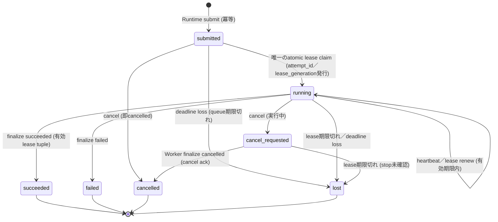

# T-098 ResearchJob v1 プロトコル設計案（Proposal）

**ステータス**：設計案（未実装・未受入）．本ファイルはT-098の文書設計提案のみを含み，実行可能なcontract／schema／endpoint，T-098の完了，採用のいずれも主張しない．すべての実行・schema検証は将来の作業（future work）として後述する．
**対象タスク**：T-098 ephy-worker protocol／job contractを設計
**関連ADR**：ADR-0003（既存 web.collect contract 0.4 との互換性維持）

## 1. スコープと非目標

### スコープ
- `ResearchJob` v1 のJSONエンベロープ定義とライフサイクル（submit／lease／heartbeat／artifact／cancel／retry／audit）の設計．
- 既存の `web.collect` contract 0.4（`src/ephy_worker/contracts.py`，`src/ephy_worker/manager.py`，`src/ephy_worker/worker_service.py` に実装済み）との明確な分離と，同一Manager上での共存可能性の担保．
- 不正なlease generationや古いrevisionによる実行を防ぐfencingメカニズムの定義．
- Runtime側での結果採用（Adoption）と，Worker側のKarte書き込み禁止の徹底．

### 非目標
- 実装コードの作成，リポジトリへの変更，Runtime／Karteとの実際の統合．
- 既存 `web.collect` 0.4 の仕様変更や廃止．v1は別の `job_type` として導入し，0.4のschema・state名・endpointを変更しない．
- 認証・認可基盤の新設（既存のHTTP header credential運用を前提とする）．
- 分散合意形成や投票による真実性の決定（Workerは独立した証拠収集のみを行う）．

## 2. 既存 web.collect 0.4 との分離と後方互換

- 0.4は実装済みの稼働契約であり，job kind は `web.collect`，state は queued／running／cancel_requested／completed／partial／failed／cancelled／lost，submit_key＋canonical input hashによる冪等submit，parent残budgetからchild budgetを導出するretry，lease／attempt構造を持つ（ADR-0003）．
- 本提案の `ResearchJob` v1 は未実装の設計案であり，`job_type: "research_job"` と `protocol_version` を明示することで0.4と混同しない．0.4のstate名・冪等性・child retry・lease／attemptの構造は参照点として再利用するが，v1の追加フィールド（後述のrevision／policy fencing）を0.4へ遼及適用しない．
- 同一Manager上で `web.collect` と `research_job` が混在する場合，job_typeごとにstate機械とfencing規則を分離して評価する（フェーズ2の将来検証）．

## 3. 依存関係と未解決事項

本設計は以下のタスクの完了状況に依存し，現状では未確認である．

- **T-033**：Runtime側のJobポリシー定義と結果採用ロジックの確定．
- **T-122**：共通knowledge-lifecycle契約（kirimine170/ephy issue 5）の確定．これはKarte連携仕様ではなく，採用済み知識のライフサイクル契約である．Karte書き込み権限の分離はT-033のRuntime採用ロジック側の前提として扱う．
- **T-084**：mainブランチへの統合確認および既存ADRとの整合性検証．

これらが未解決の間，本ドキュメントは「提案」であり，実装可能な契約としては扱わない．

## 4. バージョン付きJSONエンベロープ

すべての通信は `protocol_version` を含むJSONで行う．送信者のimmutable Submit入力と，Managerが派生するleased envelopeを分離する．Submit入力はprotocol_version，job_type，submit_key，target_revision，policy_revision，scope，policy，budget，payloadなどimmutableな全フィールドを含む．canonical full-input hashは，これらimmutableな提出フィールド全体（protocol，revisions，scope，policy，budget，payload）に対して計算し，Managerが後から割り当てるattempt_idやlease_generationはhash対象に含めない．

以下の例は，lease取得後にManagerが返す**leased envelope**の合成例である．識別子はすべてpublicな合成値であり，実Job・実スプレッドシート・資格情報・ローカルパスは含まない．

```json
{
  "protocol_version": "1.0",
  "job_type": "research_job",
  "job_id": "rjob-00000000-0000-4000-8000-000000000001",
  "parent_job_id": null,
  "submit_key": "demo-submit-key-0001",
  "full_input_hash": "<immutable全入力のcanonical SHA-256>",
  "attempt_id": "att-00000000-0000-4000-8000-000000000001",
  "lease_generation": 1,
  "target_revision": "git-sha-or-tag-example",
  "policy_revision": "policy-hash-example-v1",
  "state": "running",
  "created_at": "2026-10-15T01:00:00Z",
  "lease_expires_at": "2026-10-15T01:05:00Z",
  "payload": {
    "query_scope": "public_web_only",
    "constraints": {
      "max_results": 10,
      "allowed_domains": ["example.com"]
    }
  }
}
```

**注意**：`payload` 内には資格情報，プライベートなコンテキスト，ローカルパス，プライベートなスプレッドシートID／URLを含めない．`target_revision` と `policy_revision` は別々のfrozen期待値と独立に検証し，互いを比較しない．

## 5. ライフサイクル契約（設計記述）

### 5.1 Submit（Idempotency／冪等）
- Runtime（信頼済み提出者）がJobを作成し，Managerへ送信する．`target_revision`，`policy_revision`，scope，budgetを必須とする．
- 冪等submitはcanonical full-input hash（protocol，revisions，scope，policy，budget，payloadを含むimmutable全入力）で判定する．同一submit_keyかつ同一full inputの再送は，既存レコードを**現在の状態のまま**返す（submittedへリセットしない）．同一submit_keyでimmutable入力が異なる場合は拒否する．
- 終了状態（succeeded／failed／cancelled／lost）のJobレコードは不変であり，同一キーの再submitで再開しない．

### 5.2 Lease
- WorkerがJobをpullし，leaseを取得する．lease claimはアトミックであり，有効なactive leaseを持たないsubmitted作業に対しては複数のclaimantが競合した場合ちょうど1つだけが勝つ．勝者が確定した時点でManagerが `attempt_id` と `lease_generation` を1回だけ発行する．単一の有効claimを「後発が単純に置換する」ことは起こらない．
- Workerは `attempt_id`，`lease_generation` を含むjob／attempt／generationの完全tuple，有効なlease，独立にfrozenされた `target_revision` と `policy_revision` の一致，許可されたstateを，いかなる変更操作の前にも確認する．

### 5.3 Execute ＆ Heartbeat
- Workerは `attempt_id` と `lease_generation` をヘッダまたはペイロードに含めて実行状態を送信する．
- Heartbeatはlease有効期限の延長を試みるが，期限切れ後の延長は不可とする．期限切れはdeadline lossとしてlost扱いの対象になる．

### 5.4 Artifact
- 結果は一時アップロードし，Manager側でSHA-256とサイズを検証後に受領する．`web.collect` と同様に，許可されたmedia typeのみを受け入れる．
- artifact受領もlease tuple fencingとstate前提条件の対象であり，fencedなattemptの書き込みは拒否する．

### 5.5 Cancel
- Runtimeがcancel要求を送信する．submittedへのcancelは即cancelled，runningへのcancelはcancel_requestedとして記録し，Workerのfinalizeを待つ（0.4準拠）．
- cancel確定後の遅延結果は拒否される．cancel acknowledgementは以降の新規結果をアトミックにfenceするため，acknowledge済みcancelに対する後発の成功finalizeは受け付けない．finalizeとcancelが競合した場合，アトミックなstate前提条件で勝敗を決める．

### 5.6 Retry
- Workerは自分自身へretryや新しいattempt_idを付与できない．retryの権限は信頼済みManager／Runtimeだけが持つ．
- Runtimeが承認したretryは，trusted Managerによって**新しいchild job_id**（`parent_job_id` を設定），**新しいsubmit_key**，parent残budgetから導出した残りのみのchild budgetでの子Job作成として行われ，子Jobのアトミックなlease claim時に新しいManager発行attempt_idが発行される．
- retryはfailed／lost／cancelledの親Jobをsubmittedへ戻さない．親は終了状態のまま不変である．cancelledのJobは自動retryしない．

### 5.7 Audit
- すべての状態遷移，lease発行，artifact受領，cancel，retry（親／子の対応）を監査ログとして記録する．ログには資格情報を含めない．

## 6. 結果の冪等性とfencing

- 結果受理はfencingと取消を回避できない．新規結果は，現在runningで有効leaseを持つleased attemptからのものだけを受け付ける．
- 一度受理済みの結果と完全一致する複製の再送は，定義済みの受領規則に従い，既存の受領記録を返すだけで，新しい取り込み・Adoption・状態変化を起こさない．同一受理結果identityで内容が異なるものは拒否する．
- cancelledまたはlostのJobに対する結果提出は，旧いattempt_id／lease_generationの提示や完全一致bodyであっても拒否する．
- Runtime Adoptionは，終了済みWorker Jobの遷移ではなく，信頼済みライフサイクル上の**別記録・別判断**として扱う．Adoption前に現在の `target_revision` と `policy_revision` を再確認する．WorkerはKarteへ一切書き込まない．

## 7. 責任分界とセキュリティ

### Runtimeの責任
- Jobポリシーの定義，retryの承認，結果の採用（Adoption），Karteへの書き込み．
- WorkerはKarteへ直接書き込んではいけない．

### Workerの責任
- 公開Webからの独立した探索，反証収集，出所（provenance）の記録．
- 投票数による真実性の判断は行わない．attempt_id／lease_generationの自己発行は行わない．

### セキュリティ
- 資格情報はHTTP headerのみで伝達し，ペイロード，artifact，ログには含めない．
- 公開クエリとスコープのみを許可し，プライベートデータへのアクセスを遮断する．

## 8. 計画された状態グラフと状態遷移表

以下は1つのWorker Job（1 job_id）の状態機械の設計であり，retryによるchild Job作成はこのグラフの外側で、新しいjob_idの作成として行う．終了状態（succeeded／failed／cancelled／lost）からはどの状態への遷移も存在しない．なお0.4の実装では完了系の状態名がcompleted／partialであるが，v1では終了状態をsucceeded／failed／cancelled／lostへ統合する設計とし，0.4の名前との対応は将来のschema確定時に固定する．



| # | actor | 現在状態と前提条件 | 結果状態 | 不正／遅延遷移の扱い |
|---|-------|--------------------|----------|----------------------|
| 1 | Runtime | submit：submit_key未使用またはfull input完全一致 | submitted（新規）または既存レコードを現状態のまま返却 | 同一submit_keyでimmutable入力が異なる場合は拒否（作成しない） |
| 2 | Worker | submitted，有効active leaseなし，deadline前 | running（attempt_id／lease_generationをManagerが発行） | 競合claimはちょうど1勝者のみ．敗者は再試行せずjob viewを参照 |
| 3 | Worker | running，job／attempt／generation tuple一致，lease有効 | running（renew，lease延長） | tuple不一致，lease切れ，frozen revision不一致はrenew拒否 |
| 4 | Runtime | submittedへのcancel | cancelled（即時） | 再submittedに戻さない |
| 5 | Runtime | runningへのcancel | cancel_requested | 以後の新規結果はcancel ackでアトミックにfence |
| 6 | Worker | running，有効lease，finalize succeeded／failed | succeeded／failed | lease tuple不一致または期限切れは拒否（stale lease） |
| 7 | Worker | cancel_requested，finalize cancelled | cancelled（cancel ack） | cancel_requestedでのsucceeded／failed finalizeは拒否（cancelと競合するfinalizeはstate前提条件で負ける） |
| 8 | Sweeper／Manager | runningまたはcancel_requested，lease期限切れ | lost（stop未確認） | 以後の遅延結果は旧ID提示でも拒否 |
| 9 | Sweeper／Manager | submitted，deadline_at超過 | lost | claim拒否 |
| 10 | 任意 | 終了状態（succeeded／failed／cancelled／lost）への全操作 | 変化なし（不変） | 結果再送，cancel，retry要求，state更新はすべてterminal-state拒否 |
| 11 | Runtime（承認時） | 親がfailed／lostの終了状態 | 親は不変のまま，新job_idのchildをsubmittedとして作成（グラフ外） | 親の再開は拒否．cancelledの親はchild作成対象外（自動retryなし） |

## 9. Fencing と整合性

### 9.1 Expired／stale lease generation
- Workerが古い `lease_generation` や確定済み `attempt_id` で結果を送信した場合，Managerはjob／attempt／generation tuple，有効lease，独立frozen revision，許可stateを確認し，不一致を `stale_lease` として拒否する．これによりネットワーク遅延による「幽霊Worker」の書き込みを防ぐ．

### 9.2 Stale revision／policy revision
- `target_revision` は現在のfrozen期待 `target_revision` と，`policy_revision` は現在のfrozen期待 `policy_revision` と，それぞれ独立に一致確認する．2種類のrevisionを互いに比較しない．いずれか不一致なら実行・renew・finalizeを拒否する．
- Adoption前にも現在のrevision／policy revisionを再確認する．

## 10. 計画されている合成受入ケース（future work：未実行）

以下はすべてpublicな合成識別子だけを使う合成ケースの設計であり，実行もschema検証も本提案の範囲外（将来の作業）である．

**正方向ケース**
1. 同一submit_key・同一full input hashの重複submitが，現状態のまま既存レコードを返すこと（submittedへリセットしない）．
2. lease claim成功→renew→finalize succeededの正常経路と，lease tupleの完全一致確認．
3. 受理済み結果と完全一致する複製finalizeの再送が，受領記録の返却のみで，新しい取り込み・Adoption・状態変化を起こさないこと．

**負方向ケース**
4. 終了状態（succeeded／failed／cancelled／lost）での同一キーsubmitが，Jobを再開せず既存レコードを返すこと．
5. failed親に対するRuntime承認retryで，新しいchild job_id・新しいsubmit_key・残りのみのchild budget・child lease claim時の新attempt_idが発行され，親がterminalのまま不変であること．cancelled親はchild対象外．
6. retry後の旧親job_idまたは旧attempt_idによる遅延結果提出が拒否されること．
7. cancelled／lost Jobへの結果再送（旧ID提示，完全一致bodyを含む）が拒否されること．同一受理結果identityで内容が異なるものも拒否．
8. 同一submitted Jobへの同時lease claim競合で，ちょうど1つのclaimantだけが勝つこと．
9. lease期限切れ後のfinalize／renewが `stale_lease` で拒否されること．
10. cancel acknowledgement後の後発finalize succeededが拒否されること（finalizeとcancelの競合をアトミックなstate前提条件で解決）．
11. `protocol_version` 不一致のsubmit／通信の拒否．
12. `target_revision` 不一致と `policy_revision` 不一致を別々のケースで検証し，互いとの比較が行われないこと．
13. Adoptionが別記録であり，terminal Worker Jobがadoptedへ遷移しないこと．WorkerのKarte書き込み経路が存在しないこと．

## 11. 段階的な将来作業と未決事項

### フェーズ1：スキーマ定義とスタブ実装（将来）
- JSONスキーマの確定と，Manager／Worker間のスタブ通信によるlease／fencingロジックの検証．

### フェーズ2：web.collect 0.4 との共存検証（将来）
- 同一Manager上で `web.collect` と `research_job` が混在する場合の競合テスト．

### フェーズ3：Runtime統合（T-033／T-122依存，将来）
- Runtime側での結果採用（Adoption）ロジックとknowledge-lifecycle契約との接続，Karte書き込みの分離確認．

### 未決事項
- `policy_revision` の具体的なハッシュ生成方法．
- `lease_generation` の永続化と復旧時の挙動．
- 大規模artifactのストリーミングアップロードの可否．
- 0.4 state名（completed／partial）とv1終了状態（succeeded／failed）の対応確定．

---
**注記**：本ドキュメントはT-098の設計候補であり，承認・実装完了・採用を示すものではない．記載した状態機械，fencing，Adoption，全受入ケースは未実装の設計であり，実行可能なcontract／schema／endpointの存在やT-098の完了を主張しない．
